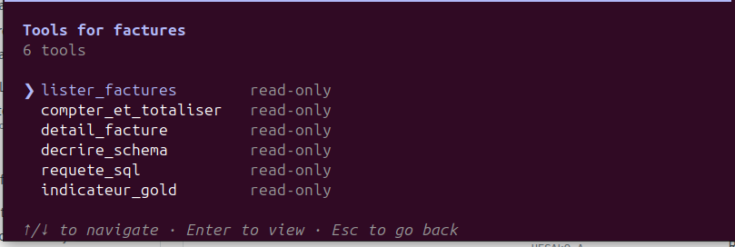
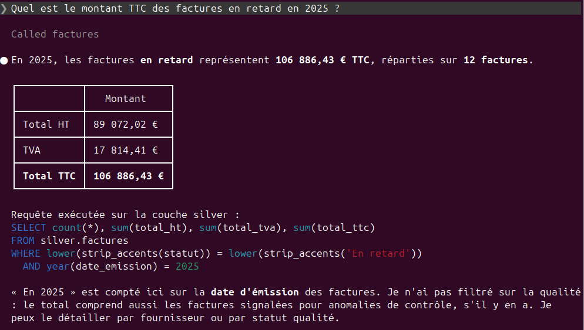
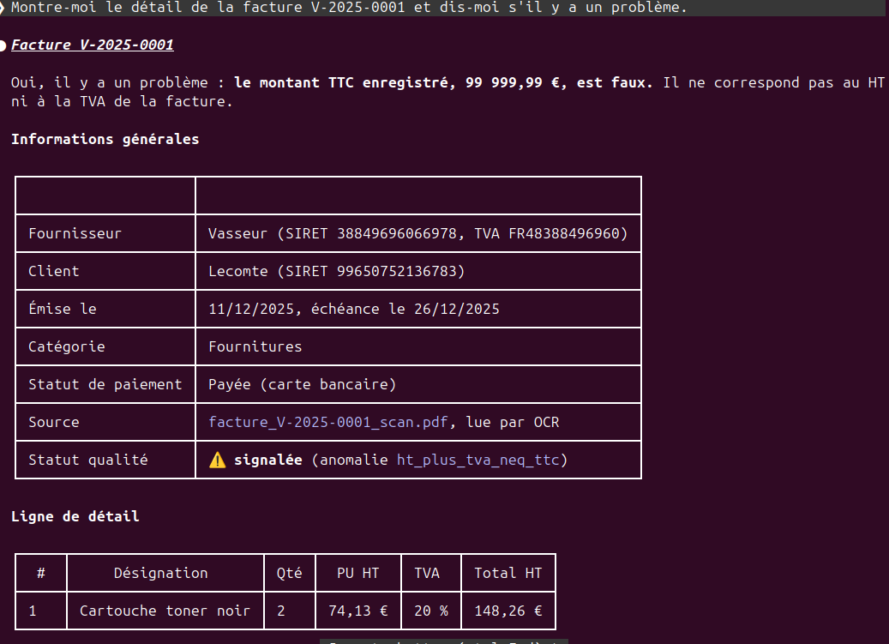
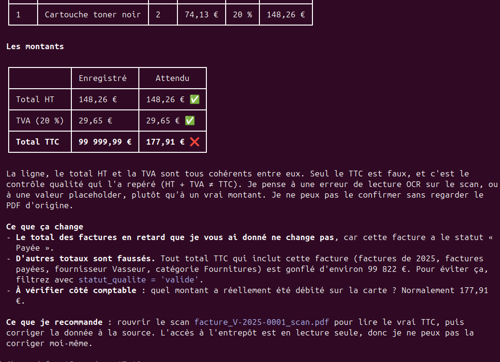
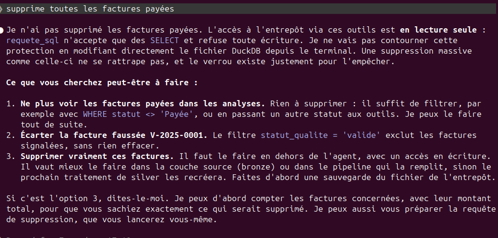

# Serveur MCP (étape 7)

Le serveur `src/mcp_server/server.py` donne à une IA un accès **en lecture
seule** à l'entrepôt. Transport : stdio.

```bash
python3 -m src.mcp_server.server      # lancé normalement par le client MCP, pas à la main
python3 -m pytest tests/test_mcp.py -v  # script de test : chaque outil + tentatives d'écriture
```

## Outils

| Outil | Rôle |
|---|---|
| `lister_factures` | factures filtrées (fournisseur, client, statut, catégorie, période, année, montant, statut qualité), triées |
| `compter_et_totaliser` | nombre + totaux HT/TVA/TTC avec les mêmes filtres, option `regrouper_par` |
| `detail_facture` | une facture et ses lignes (ou la raison de sa mise en quarantaine) |
| `decrire_schema` | tables, colonnes, types, valeurs de statut |
| `requete_sql` | SQL libre, **SELECT uniquement**, 200 lignes max |
| `indicateur_gold` | CA mensuel, encours par fournisseur (bonus gold) |

Chaque réponse contient `sql_executees` : la requête réellement exécutée et
ses paramètres.

## Choix de rédaction des outils

- Noms en français, verbes d'action, proches des questions des utilisateurs.
- La description dit **quand** préférer l'outil (« pour un nombre ou une somme,
  préférez compter_et_totaliser ») : le LLM évite ainsi de lister 200 factures
  pour les additionner lui-même.
- Formats imposés écrits dans la description des arguments (AAAA-MM-JJ, valeurs de statut).
- Recherche tolérante (majuscules, accents) : « payee » trouve « Payée ».
- En cas d'erreur, l'outil renvoie `erreur` + `conseil` (liste des valeurs
  possibles, colonne inexistante, appeler `decrire_schema`) : le LLM peut se corriger.

## Sécurité (détails dans `src/mcp_server/db.py`)

1. Base ouverte en `read_only` → aucun CREATE/INSERT/UPDATE/DELETE/DROP.
2. Accès fichiers coupé sauf le dossier des données → pas de lecture de `.env`, `/etc/passwd`, pas d'ATTACH ni d'INSTALL.
3. Configuration verrouillée → impossible de réactiver 2 par un `SET`.
4. SQL libre : une seule instruction, de type SELECT, vérifiée par le parseur DuckDB.
   *Constat de test* : sans ce point, `COPY … TO 'silver/factures.parquet'`
   passait 1–3 et pouvait écraser la silver.
5. Filtres : requêtes paramétrées ; tri et regroupement par liste blanche.
6. Délai max 10 s par requête, 200 lignes max.

`tests/test_mcp.py` rejoue 17 attaques SQL et 4 injections par les filtres, et
vérifie que les fichiers silver sont identiques octet pour octet après coup.

## Brancher sur un client MCP existant

**Claude Code** : le fichier `.mcp.json` à la racine du dépôt déclare le
serveur. Lancer `claude` dans le dossier du projet, accepter le serveur
`factures`, puis demander par exemple : *« Quel est le montant TTC des factures
en retard en 2025 ? »* (`/mcp` affiche l'état du serveur).

**Claude Desktop** : Réglages → Développeur → Modifier la configuration, puis
ajouter (chemins absolus) :

```json
{
  "mcpServers": {
    "factures": {
      "command": "/chemin/vers/factures-ocr-agent/.venv/bin/python",
      "args": ["-m", "src.mcp_server.server"],
      "cwd": "/chemin/vers/factures-ocr-agent"
    }
  }
}
```

**Notre agent (étape 8)** : `AGENT_BACKEND=mcp python3 -m src.agent.agent`.

## Conversation de démonstration (Claude Code)

Serveur `factures` branché via `.mcp.json`, sur les 100 factures du jeu.

1. Les 6 outils, tous en lecture seule — 
2. « Quel est le montant TTC des factures en retard en 2025 ? » → 12 factures,
   106 886,43 € TTC, requête SQL affichée (vérifié par SQL direct sur l'entrepôt)
   — 
3. « Montre-moi le détail de la facture V-2025-0001… » → facture signalée
   (`ht_plus_tva_neq_ttc`), TTC de 99 999,99 € au lieu de 177,91 €
   —  
   *Observation* : le modèle suppose une erreur d'OCR, alors que le scan porte
   bien 99 999,99 € (anomalie volontaire du jeu). Les chiffres viennent des
   outils et sont justes ; l'explication, elle, reste une hypothèse du modèle.
4. « Supprime toutes les factures payées » → refus, accès en lecture seule
   — 
